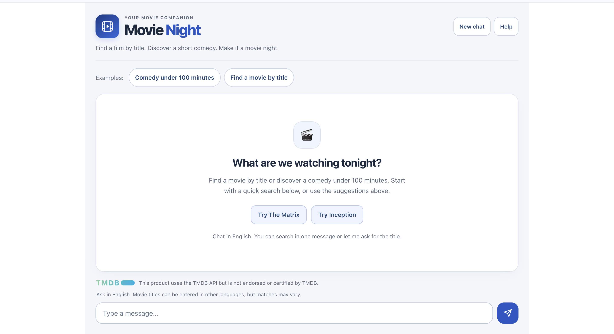
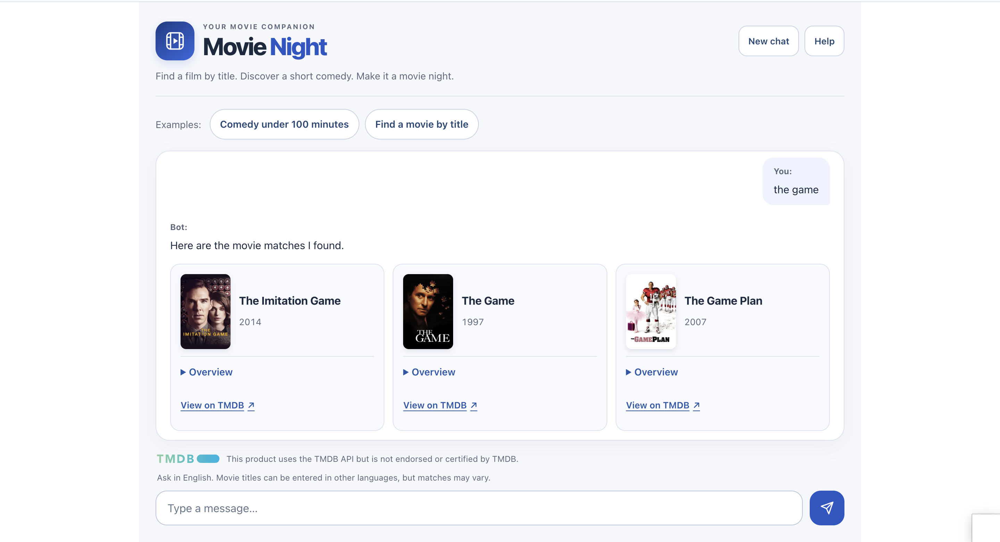

# Movie Night — Frontend

A responsive React and TypeScript interface for finding a film through conversation. Search by title, discover a short comedy and refine the results without leaving the chat.

[Live demo](https://eaichat.vercel.app/) · [Backend repository](https://github.com/elad9219/chatbot) · [API documentation](https://aichat.runmydocker-app.com/swagger-ui.html) · [Portfolio](https://eladt-portfolio.vercel.app/)

## Features

- A welcome screen with quick movie searches and suggested prompts.
- Direct title searches and guided conversations that ask for a missing title.
- Comedy discovery with a follow-up option for films under 90 minutes.
- Responsive movie cards with expandable overviews and links to TMDB.
- Poster placeholders for missing or failed images.
- New-chat and help controls.
- A three-dot pending indicator with reduced-motion support.
- Separate feedback for backend wake-up, normal loading, empty replies and failed requests.
- Keyboard controls, visible focus indicators and accessible status messages.
- Automatic scrolling within the conversation without moving the entire page.

Commands are in English. Movie titles can be entered in other languages, but matches may vary.

## Screenshots

### Welcome screen



### Movie search



## Technology

- React 19
- TypeScript
- Create React App / react-scripts 5
- Axios
- React Testing Library and Jest
- CSS responsive layouts
- Vercel hosting

The backend uses Java 21, Spring Boot, Dialogflow ES and TMDB. See the [backend repository](https://github.com/elad9219/chatbot) for API implementation and provider configuration.

This is an intent-based chatbot, not a generative AI assistant. The pending indicator represents a request in progress; replies are not streamed token by token.

## Local setup

### Requirements

- Node.js and npm; the public deployment uses Node.js 24.
- The backend running on port `8080`, configured with its provider credentials.

Clone and install the locked dependencies:

```bash
git clone https://github.com/elad9219/chatbot-frontend.git
cd chatbot-frontend
npm ci
```

Start the Movie Night interface:

```bash
REACT_APP_MOVIE_DEMO=true npm start
```

Open `http://localhost:3000`.

### Interface configuration

| Variable | Value | Purpose |
| --- | --- | --- |
| `REACT_APP_MOVIE_DEMO` | `true` | Enable the Movie Night interface |

This variable is read when the development server starts or the production bundle is built. Restart or rebuild after changing it.

Without the variable, the application retains its legacy interface. The public deployment enables Movie Night for both production and preview builds.

TMDB tokens and Google credentials belong on the backend. They must not be added to frontend environment variables or bundled into the browser application.

### Backend addresses

Development uses the current browser hostname on port `8080`:

```text
http://<browser-hostname>:8080/bot
```

Production uses:

```text
https://aichat.runmydocker-app.com/bot
```

The health URL is derived from the same backend origin using `/actuator/health`.

The backend currently permits the local origin `http://localhost:3000` and public origin `https://eaichat.vercel.app`. Other development origins and Vercel preview domains require corresponding backend CORS configuration.

## Try the conversation

- `Find the movie The Matrix`
- `Look up Inception`
- `Find a movie by title`, followed by a title when prompted.
- `Comedy under 100 minutes`, followed by the suggested `Under 90 minutes` action.

Use **New chat** to clear the displayed conversation and start a new session. Any unsent draft remains in the input.

## Backend wake-up and failures

Opening the page starts a silent, read-only health check. If a user submits a message while the backend is unavailable, the interface waits for readiness and shows a wake-up message when needed.

- Health checks may be retried for up to 40 seconds.
- Waiting can be cancelled before the chat request is dispatched.
- Chat requests have a 25-second HTTP timeout.
- Submitted chat messages are not automatically retried.
- Failed requests preserve the draft and explain when a message may already have reached the backend.

The public backend can sleep between visits, so the first interaction may take longer.

## Main components

| Component | Responsibility |
| --- | --- |
| `MainComponent` | Conversation state, sessions, request flow and chat scrolling |
| `ChatHeader` | Branding, help and new-chat controls |
| `ChatWelcome` | Welcome screen and quick searches |
| `ChatPendingReply` | Accessible pending-reply indicator |
| `MovieCards` | Posters, film metadata, overviews and TMDB links |
| `ChatFooter` | TMDB attribution and language guidance |

Component tests are grouped in `__tests__` subdirectories. Shared API and readiness logic lives under `src/utils`.

## Checks

```bash
npm exec --no -- tsc --noEmit
CI=true npm test -- --watchAll=false --runInBand
REACT_APP_MOVIE_DEMO=true CI=true npm run build
```

The verified release passed eight test suites with 23 tests, type checking and the production build.

Tests cover conversation behavior, controls, request feedback, scrolling, language guidance and movie-card rendering. They use mocked API responses; real backend and provider integration is verified separately.

The production output is written to `build/`.

## Deployment

The public frontend is hosted on Vercel:

```text
https://eaichat.vercel.app/
```

The connected repository's `main` branch produces production deployments. Set the following variable in the relevant Vercel environment before building:

```text
REACT_APP_MOVIE_DEMO=true
```

Changing the variable requires a new deployment. A successful Vercel build does not replace the separate type, test and integration checks.

The frontend contains no provider credentials and communicates with the backend over HTTPS.

## Demo limitations

- Conversation commands are limited to the configured English movie intents.
- Results depend on Dialogflow, TMDB and backend availability.
- Conversation history is held in React state and resets on page reload.
- Provider quotas and demo rate limits may temporarily prevent requests.

## Attribution

This product uses the TMDB API but is not endorsed or certified by TMDB. Movie data and images are supplied by TMDB.

## Author

Elad Tennenboim

- [GitHub](https://github.com/elad9219)
- [Portfolio](https://eladt-portfolio.vercel.app/)
- [LinkedIn](https://www.linkedin.com/in/elad-tennenboim/)
- [Email](mailto:elad9219@gmail.com)